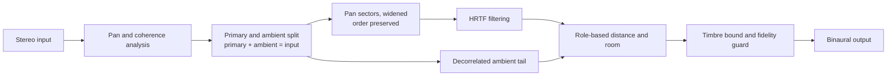

# Stage

**A spatial audio engine that lives inside the music app: any song, any phone, no Dolby hardware, artist in control.**

[](https://github.com/danielomoteshohacks/stage-spatial-audio/actions/workflows/ci.yml)
[](LICENSE)


> Stage is an independent research and engineering project. It is not affiliated with, or endorsed by, Spotify, Apple or Dolby.

---

## Why this exists

Streaming services now compete on sound. Lossless audio has become common, and spatial audio is the
next gap. Today, spatial music mostly means a dedicated Dolby Atmos mix of each song, and on
Android the experience also depends on the phone maker supplying Dolby support: without it, the
same track plays in plain stereo. Spotify offers lossless, and as of early 2026 no native spatial format.

Stage asks a different question: **what if the app itself owned the renderer?** Then it would work on any
phone, on any song, and the artist could decide whether their track receives it.

## The idea in one minute

Most stereo upmixers invent positions. Stage does the opposite: **it keeps every sound where the stereo
mix already puts it**, spreads those positions around the listener, gives each role an appropriate
distance, and adds a believable room. A fidelity guard compares every render with the original so the
record is never rewritten.



Four properties define the design:

1. **Position-preserving.** A sound left of another in the original stays left of it.
2. **Role-aware.** Kick, bass and lead vocal stay close and dry; pads and effects get space.
3. **Faithful.** Long-term tone, low end, loudness and timing are checked against the original.
4. **Light.** The lightest tier needs no neural network and is designed to run in real time on a phone.

## Three complete tiers

| Tier | Neural network | Runs where | What it adds |
|---|---|---|---|
| **Lite** | None | On the device, real time | Pan-anchored rendering of the whole mix; works on any song instantly |
| **Standard** | Small separation model | Offline, once per track | Per-stem roles and distances |
| **Studio** | Separation plus refiner | Offline, once per track | Cleaner stems on hard passages, for flagship tracks |

Each tier is a complete product, not a stripped-down demo. Every tier must beat the one below it in
blind listening tests to earn its cost.

## How we know it works

No claim is made without a measurement. Each claim is a hypothesis with a pass condition written
before the test is run (see [`experiments/`](experiments/)).

| Claim | Gate |
|---|---|
| Lite is preferred over a generic stereo virtualiser | Lower end of the 95 percent interval above 50 percent |
| The timbre bound keeps the tone without losing direction | Average deviation at most 1.5 dB |
| Role-based distance beats one room for everything | Preferred in blind A/B |
| The real-time core is light | WebAssembly at most 300 KB; CPU at most 5 percent of one mid-range phone core |
| Triage-and-refine keeps the ensemble's gain cheaply | At least 90 percent of the gain at no more than 40 percent of the cost |

Results, including failures, will be published here with sample sizes and confidence intervals.

## Status

Early development. Nothing here yet makes a performance claim.

- [ ] **Slice 1, Hear it:** one clip spatialised by Lite in Python
- [ ] **Slice 2, Prove it:** measurements and a first blind test
- [ ] **Slice 3, Make it smart:** stems, roles, style templates
- [ ] **Slice 4, Make it light:** Rust core and WebAssembly, real time in the browser
- [ ] **Slice 5, Show it:** demo, efficiency chart, write-up, video

See [`docs/roadmap.md`](docs/roadmap.md).

## Repository layout

| Path | Purpose | Status |
|---|---|---|
| [`src/stage/`](src/stage/) | Python reference implementation (the oracle) | active |
| [`schemas/`](schemas/) | JSON Schemas for the plan, report and consent files | active |
| [`tests/`](tests/) | Unit, property, golden-file and integration tests | active |
| [`docs/`](docs/) | Specifications, architecture, roadmap, decision records | active |
| [`experiments/`](experiments/) | Hypotheses, gates and results | active |
| [`stage-core/`](stage-core/) | Rust real-time core, compiled to WebAssembly | planned |
| [`tools/hrtf-pack/`](tools/hrtf-pack/) | Converts open SOFA data into a compact pack | planned |
| [`web/`](web/) | Browser demo and blind listening test | planned |
| [`android/`](android/) | Optional Android client | planned |
| [`configs/`](configs/) | Style templates, modes, guard thresholds | planned |
| [`models/`](models/) | Model manifest (files are never committed) | planned |
| [`data/`](data/) | Dataset manifest (audio is never committed) | planned |
| [`benchmarks/`](benchmarks/) | Reproducible performance measurements | planned |
| [`examples/`](examples/) | Small runnable examples | planned |
| [`scripts/`](scripts/) | Download, verify and evaluation helpers | planned |

## Quick start

```bash
git clone https://github.com/danielomoteshohacks/stage-spatial-audio.git
cd stage-spatial-audio
python -m venv .venv
source .venv/bin/activate          # Windows Git Bash: source .venv/Scripts/activate
python -m pip install -e ".[dev]"
ruff check . && pytest -q
```

## Documentation

- [`docs/specs/`](docs/specs/): the project plan and the technical build specification (version 2)
- [`docs/architecture.md`](docs/architecture.md): the system and its data contracts
- [`docs/decisions/`](docs/decisions/): why each major choice was made, and what else was considered
- [`docs/roadmap.md`](docs/roadmap.md): the five slices

## Principles

- **True to the record.** Change position, not the performance.
- **Measured.** Report sample sizes and intervals, including failures.
- **Light.** Heavy work runs offline; what runs on the device stays small.
- **Open and clean.** Only audio that is owned or licensed; every model and dataset licence is recorded.
- **Artist in control.** Spatial processing is opt-in with preview and approval.

## Music, data and licensing policy

- No audio, models or datasets are committed. Manifests record source and licence.
- Only music that is owned, used with written permission, or openly licensed appears in demos.
- Spotify audio, previews and API data are **never** used for training, testing or demos.
- Pretrained model weights are treated as research-only until their licence is confirmed.

## Prior art and acknowledgements

Stage builds on established research and says so: panning-index and ambience extraction
(Avendano and Jot), azimuth discrimination and resynthesis (Barry and colleagues), primary-ambient
extraction (He, Tan and Gan, and others), stereo position estimation (Kraft and Zolzer), source
separation models (Demucs, SCNet, RoFormer families), and open head-related transfer function
datasets (used with attribution). Some structures used in commercial binaural virtualisers are
patented; Stage avoids copying them and a freedom-to-operate check is planned before any product claim.

## Contributing

See [`CONTRIBUTING.md`](CONTRIBUTING.md). Experiments use the Experiment issue template.

## Licence

Code is licensed under [Apache-2.0](LICENSE). Models and datasets keep their own licences.
