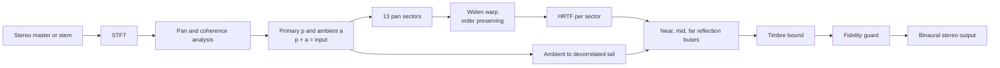
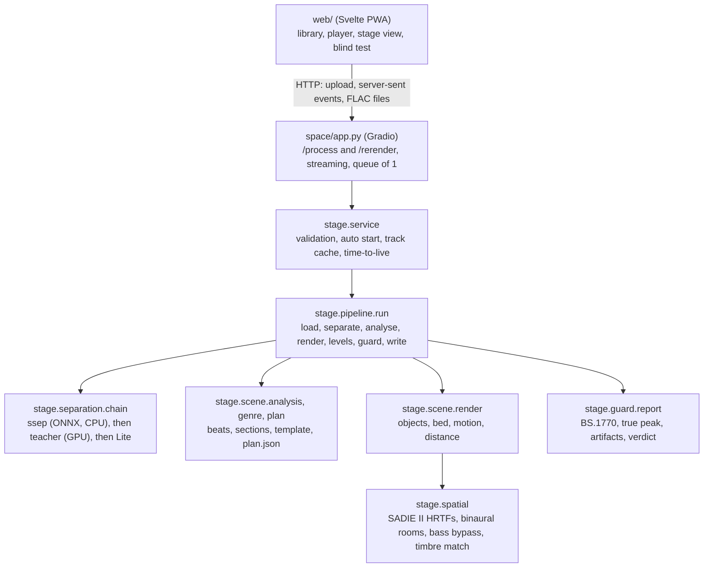

# Architecture

SoundStage turns one stereo master into a spatial render by keeping every sound where the stereo mix
already places it, widening those positions, giving each role its own distance, and adding a room.

## Tiers

| Tier | Needs a neural network | Runs where | Input to the flow |
|---|---|---|---|
| Lite | No | On the device, real time | The whole mix |
| Standard | Yes, small | Offline, once per track | Each stem |
| Studio | Yes, small plus refiner | Offline, once per track | Cleaner stems |

## Contracts between stages

Stages exchange only files with schemas in [`schemas/`](../schemas/): the **plan**, the
**report**, the **consent** record, and the **run** report that the pipeline writes for every
processed track. Audio is 44.1 kHz stereo, computed in 32-bit float and
stored as 24-bit FLAC. A render has exactly the same length as its input.

## Pipeline, service and web layers

The listening bench (decision 0009) wraps the reference renderer in three thin layers. Each layer
only calls the one below it; the renderer in `src/stage/render` is not changed by any of them.

- **Pipeline** (`stage.pipeline.run`): seven stages, each recorded as ok, failed or skipped with
  its duration and error; no failure escapes. Separation runs through the fallback chain
  (decision 0015) and each attempt is recorded. v2 builds a plan from the song analysis and the
  genre template (or renders an edited plan), renders the scene, and writes report.json
  (decision 0011), plan.json, per-object stems and optionally a 7.1.4 bed.
- **Service** (`stage.service`): validates the upload, picks the loudest excerpt by default,
  caches the excerpt, stems, analysis and genre per track for re-renders without re-separating,
  and deletes everything after 30 minutes.
- **App** (`space/app.py`): runs on a laptop and on the Hugging Face ZeroGPU Space; only the
  teacher separator is inside `@spaces.GPU`. At start-up it fetches the HRTF pack, the genre
  tagger and, once published, the SoundStage Separator weights.
- **Web** (`web/`): plays the original, the render and the object stems from AudioBuffers started
  at one AudioContext time; switches with a 30 ms cross-fade; keeps renders in IndexedDB.

## Mapping from the specification to this repository

| Specification | Here |
|---|---|
| Python reference renderer and analysis | `src/stage/analysis`, `src/stage/render` |
| Offline engine (separation, plan, guard) | `src/stage/separation`, `src/stage/scene`, `src/stage/guard` |
| Measured HRTFs and binaural rooms | `src/stage/spatial`, `tools/hrtf-pack/`, `configs/spaces/` |
| Separator training | `training/` (Kaggle) |
| Rust real-time core | `stage-core/` |
| HRTF pack tool | `tools/hrtf-pack/`, built by `.github/workflows/hrtf-pack.yml` |
| Offline pipeline and its CLI | `src/stage/pipeline.py`, `scripts/process_track.py` |
| Processing service and API | `src/stage/service.py`, `space/` |
| Web demo and listening bench | `web/` |
