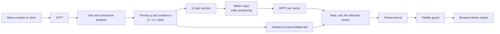
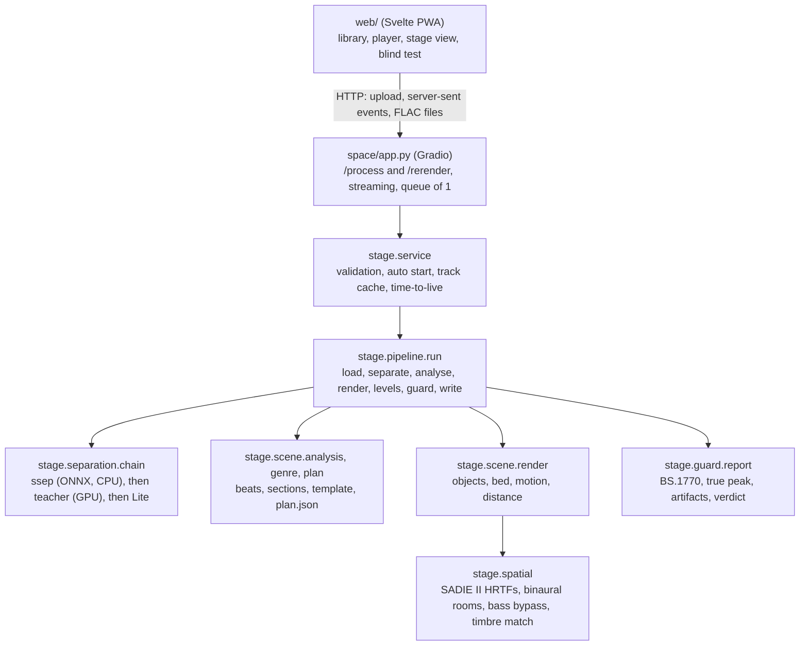

# Architecture

SoundStage turns one stereo master into a spatial render. v1 and v2 keep every sound where the
stereo mix places it and widen those positions (the diagram below). **v3 treats the song as
objects**: it separates the mix into many parts, places each part at its own point in space as a dry
source through a measured head, moves parts on musical events, and returns the room that was in
the recording as a diffuse field around the listener. The v3 sections come first; the v2 flow
that follows is still what runs on a song when v3 is switched off.

## v3 at a glance

```mermaid
flowchart LR
    A[Song or catalogue track] --> B[Chunk planner<br/>8 s, then 20 s, 1.5 s overlap]
    B --> C[Separation cascade<br/>6 levels, post-processing,<br/>quality score and merge-back]
    C --> D[Leaves and a dereverb return]
    D --> E[Plan v3<br/>role, placement template,<br/>events, speed and range caps]
    E --> F[Object renderer<br/>dry source, early reflections,<br/>SADIE II head, return as a ring]
    F --> G[Neutrality and guard]
    G --> H[Assembler<br/>sin-squared cross-fades]
    H --> I[Opus segments<br/>served while rendering]
    I --> J[StreamPlayer<br/>sample-locked A/B]
```

- **Cascade** (`stage.separation.cascade`, decision 0023): a band-split ensemble per level, a karaoke
  split, a six-stem model, a drum model, a dereverb model guarded to 10 dB, then ADRess azimuth
  splits with soft masks, multichannel Wiener, mixture consistency, a musical-noise detector with
  targeted repair, and a per-leaf quality score that merges a leaf back into its parent when it
  is not good enough. Each level is cached by content hash. Presets: best, fast, cpu (the cpu preset
  needs no model and is what runs when no weights are available).
- **Placement** (`stage.scene3.plan`, decision 0024): positions come from data
  (`configs/placement/roles.json` and each genre's `v3` block), never from code. Events (riser,
  lift, fill, throw) move an object along a smoothstep path; speed and range caps scale the
  amplitude of a move, not its timing.
- **Renderer** (`stage.scene3.render`, decisions 0025 and 0026): each object is a dry point source
  convolved with the HRTF of its direction, plus a sparse early-reflection set (80 ms at most, no
  late tail). The reverb the dereverb model removed returns as decorrelated velvet noise on a
  side, rear and height ring. Below 120 Hz the record passes through. The HRTF head is chosen
  from several measured ones, or by the listener in the calibration game.
- **Streaming** (`stage.stream`, `stage.server.api`, decision 0027): a job is a generator; each
  finished region becomes an Opus (or AAC) segment, served over HTTP while the rest renders. The job
  runs inside a Gradio event so ZeroGPU quota is attributed to the visitor.
- **Catalogue** (`stage.catalogue`, decision 0028): openly licensed music that may be adapted
  (CC BY, CC BY-SA, CC0, PDM; never ND), verified, with shelves, search and a credit line, from
  Openverse and Jamendo; a weekly workflow pre-renders it into a dataset.
- **App** (`web/`, decision 0029): Svelte 5; the player plays the original at once and switches to
  the spatial side when the first contiguous segment lands. Library, calibrated head and backend
  address stay in the browser.

## v2 at a glance

## Tiers

| Tier | Needs a neural network | Runs where | Input to the flow |
|---|---|---|---|
| Lite | No | On the device, real time | The whole mix |
| Standard | Yes, small | Offline, once per track | Each stem |
| Studio | Yes, small plus refiner | Offline, once per track | Cleaner stems |

## Contracts between stages

Stages exchange only files with schemas in [`schemas/`](../schemas/): the **plan**, the
**report**, the **consent** record, and the **run** report that the pipeline writes for every
processed track. Audio is 44.1 kHz stereo, computed in 32-bit float and
stored as 24-bit FLAC. A render has exactly the same length as its input.

## Pipeline, service and web layers

The listening bench (decision 0009) wraps the reference renderer in three thin layers. Each layer
only calls the one below it; the renderer in `src/stage/render` is not changed by any of them.

- **Pipeline** (`stage.pipeline.run`): seven stages, each recorded as ok, failed or skipped with
  its duration and error; no failure escapes. Separation runs through the fallback chain
  (decision 0015) and each attempt is recorded. v2 builds a plan from the song analysis and the
  genre template (or renders an edited plan), renders the scene, and writes report.json
  (decision 0011), plan.json, per-object stems and optionally a 7.1.4 bed.
- **Service** (`stage.service`): validates the upload, picks the loudest excerpt by default,
  caches the excerpt, stems, analysis and genre per track for re-renders without re-separating,
  and deletes everything after 30 minutes.
- **App** (`space/app.py`): runs on a laptop and on the Hugging Face ZeroGPU Space; only the
  teacher separator is inside `@spaces.GPU`. At start-up it fetches the HRTF pack, the genre
  tagger and, once published, the SoundStage Separator weights.
- **Web** (`web/`): plays the original, the render and the object stems from AudioBuffers started
  at one AudioContext time; switches with a 30 ms cross-fade; keeps renders in IndexedDB.

## Mapping from the specification to this repository

| Specification | Here |
|---|---|
| v3 separation cascade | `src/stage/separation/cascade/`, `configs/cascade/models.json` |
| v3 object renderer and placement | `src/stage/scene3/`, `configs/placement/`, `configs/spaces/` |
| Whole-song streaming | `src/stage/stream/`, `src/stage/server/api.py` |
| Catalogue | `src/stage/catalogue/`, `configs/catalogue/seed.json` |
| Python reference renderer and analysis | `src/stage/analysis`, `src/stage/render` |
| Offline engine (separation, plan, guard) | `src/stage/separation`, `src/stage/scene`, `src/stage/guard` |
| Measured HRTFs and binaural rooms | `src/stage/spatial`, `tools/hrtf-pack/`, `configs/spaces/` |
| Separator training | `training/` (Kaggle) |
| Rust real-time core | `stage-core/` |
| HRTF pack tool | `tools/hrtf-pack/`, built by `.github/workflows/hrtf-pack.yml` |
| Offline pipeline and its CLI | `src/stage/pipeline.py`, `scripts/process_track.py` |
| Processing service and API | `src/stage/service.py`, `space/` |
| Web demo and listening bench | `web/` |
