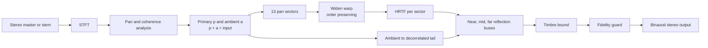

# Architecture

Stage turns one stereo master into a spatial render by keeping every sound where the stereo mix
already places it, widening those positions, giving each role its own distance, and adding a room.

## Tiers

| Tier | Needs a neural network | Runs where | Input to the flow |
|---|---|---|---|
| Lite | No | On the device, real time | The whole mix |
| Standard | Yes, small | Offline, once per track | Each stem |
| Studio | Yes, small plus refiner | Offline, once per track | Cleaner stems |

## Contracts between stages

Stages exchange only files with schemas in [`schemas/`](../schemas/): the **plan**, the
**report** and the **consent** record. Audio is 44.1 kHz stereo, computed in 32-bit float and
stored as 24-bit FLAC. A render has exactly the same length as its input.

## Mapping from the specification to this repository

| Specification | Here |
|---|---|
| Python reference renderer and analysis | `src/stage/analysis`, `src/stage/render` |
| Offline engine (separation, plan, guard) | `src/stage/separation`, `mixplan`, `guard` |
| Rust real-time core | `stage-core/` |
| HRTF pack tool | `tools/hrtf-pack/` |
| Web demo | `web/` |
