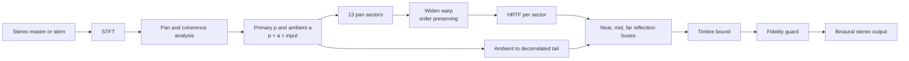
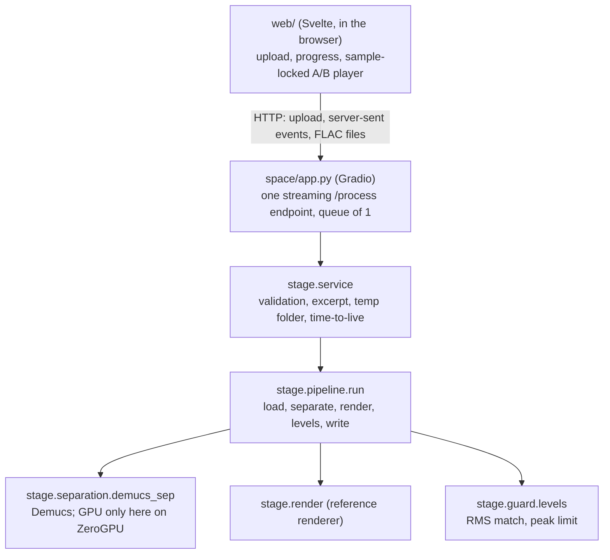

# Architecture

SoundStage turns one stereo master into a spatial render by keeping every sound where the stereo mix
already places it, widening those positions, giving each role its own distance, and adding a room.

## Tiers

| Tier | Needs a neural network | Runs where | Input to the flow |
|---|---|---|---|
| Lite | No | On the device, real time | The whole mix |
| Standard | Yes, small | Offline, once per track | Each stem |
| Studio | Yes, small plus refiner | Offline, once per track | Cleaner stems |

## Contracts between stages

Stages exchange only files with schemas in [`schemas/`](../schemas/): the **plan**, the
**report**, the **consent** record, and the **run** report that the pipeline writes for every
processed track. Audio is 44.1 kHz stereo, computed in 32-bit float and
stored as 24-bit FLAC. A render has exactly the same length as its input.

## Pipeline, service and web layers

The listening bench (decision 0009) wraps the reference renderer in three thin layers. Each layer
only calls the one below it; the renderer in `src/stage/render` is not changed by any of them.

- **Pipeline** (`stage.pipeline.run`): every stage records ok, failed or skipped, with its
  duration and error, and no failure escapes. If separation fails or is unavailable, the whole mix
  is rendered in Lite and the fallback is recorded. In stems mode the stems are rendered one at a
  time and summed, so peak memory stays near that of one Lite render. Outputs are 24-bit FLAC
  plus `run.json` ([`schemas/run.schema.json`](../schemas/run.schema.json)).
- **Service** (`stage.service`): pure Python, no Gradio. It validates the upload (type, size, at
  most 12 minutes), chooses the excerpt (30 s from 30 s in by default), runs the pipeline in a
  fresh folder and deletes runs after 30 minutes.
- **App** (`space/app.py`): the same file runs on a laptop and on a Hugging Face ZeroGPU Space.
  Only the separation call is wrapped in `@spaces.GPU`.
- **Web** (`web/`): plays the original, the spatial render and the spatial stems from AudioBuffers
  started at one AudioContext time, and switches with a 30 ms gain crossfade.

## Mapping from the specification to this repository

| Specification | Here |
|---|---|
| Python reference renderer and analysis | `src/stage/analysis`, `src/stage/render` |
| Offline engine (separation, plan, guard) | `src/stage/separation`, `mixplan`, `guard` |
| Rust real-time core | `stage-core/` |
| HRTF pack tool | `tools/hrtf-pack/` |
| Offline pipeline and its CLI | `src/stage/pipeline.py`, `scripts/process_track.py` |
| Processing service and API | `src/stage/service.py`, `space/` |
| Web demo and listening bench | `web/` |
